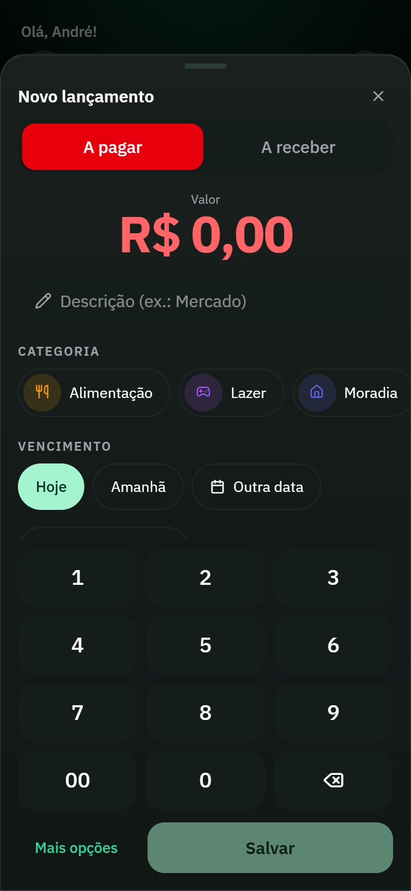
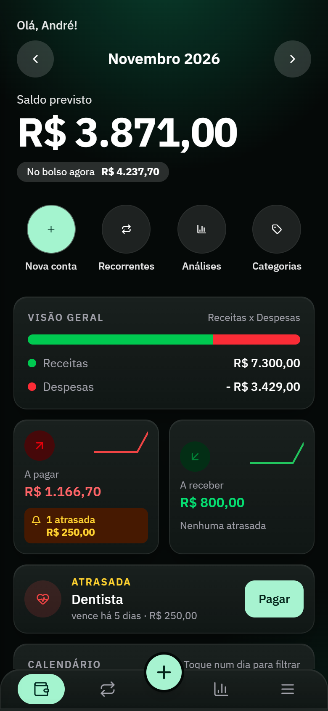
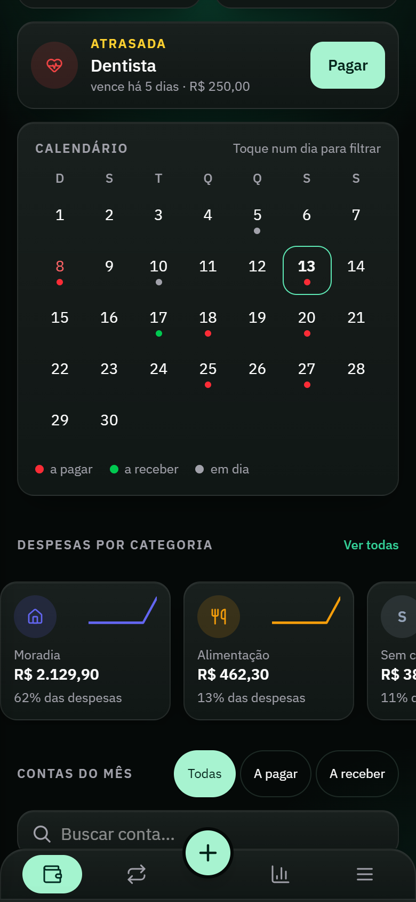
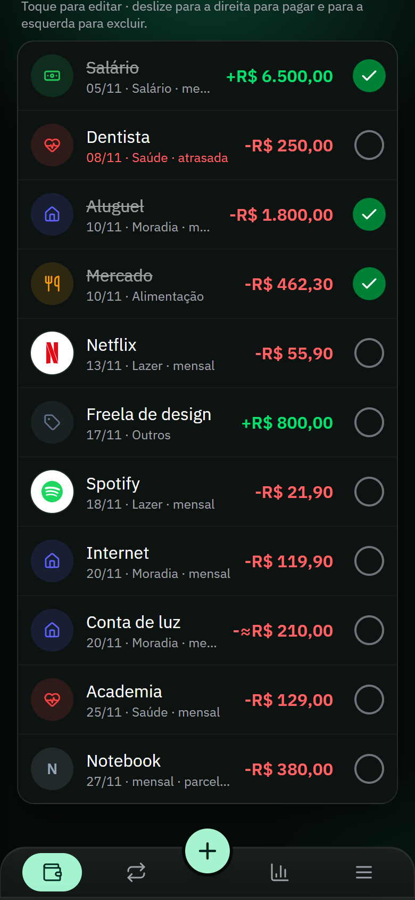
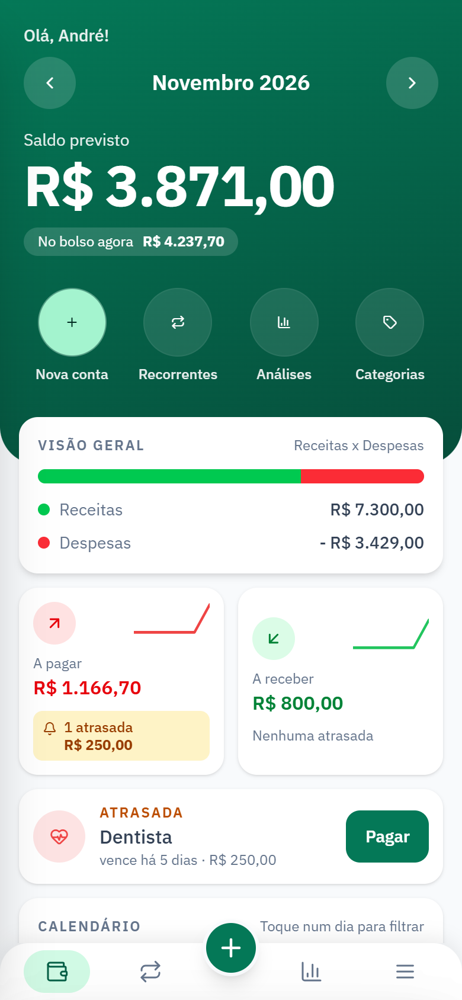
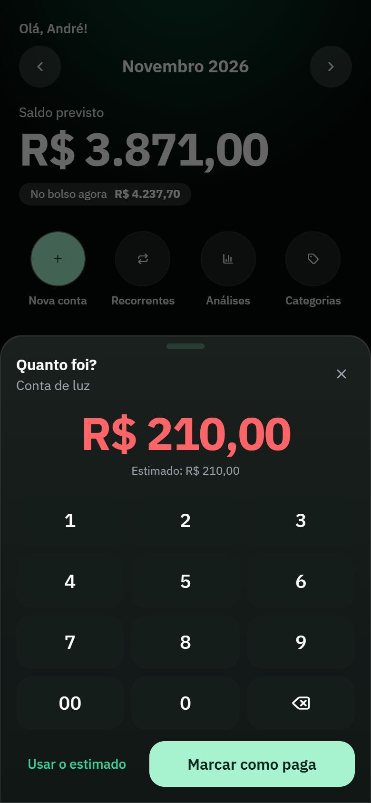
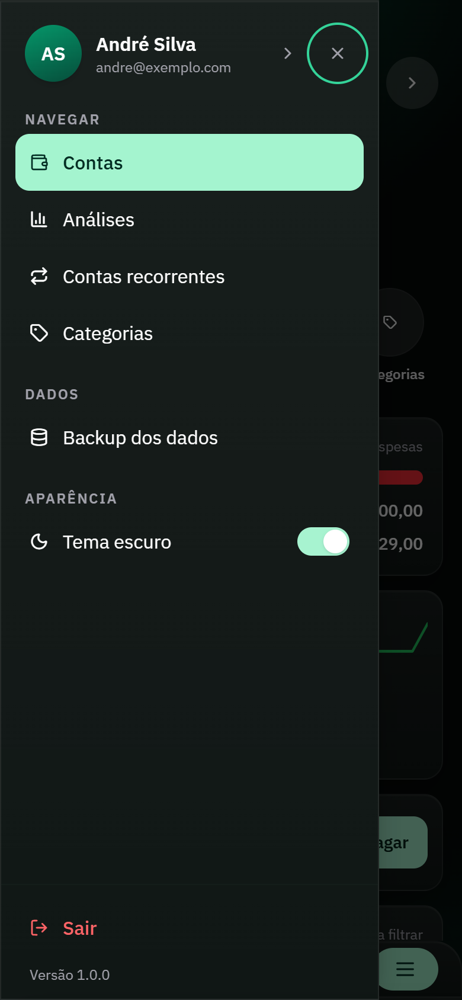
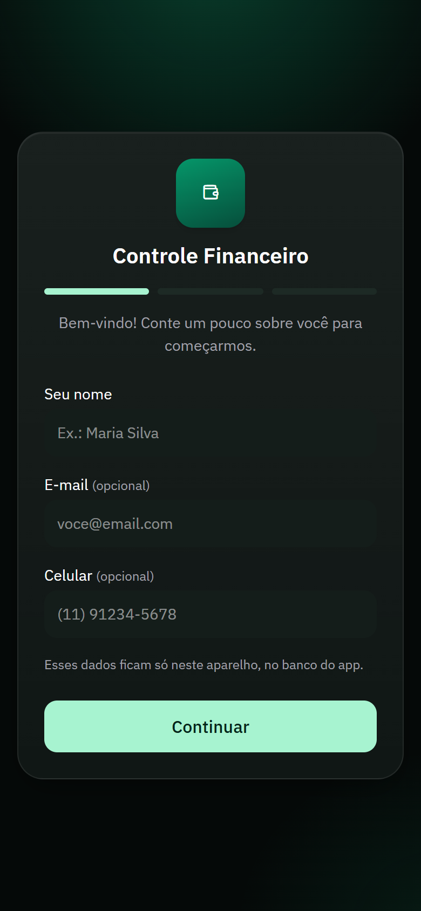

# Controle Financeiro

App pessoal de **contas a pagar e a receber**, com contas que se repetem todo mês, parcelas e contas de valor variável (luz, água...). Funciona **100% offline**: os dados ficam em um SQLite dentro do próprio aparelho, sem API e sem servidor. Feito com Angular + Capacitor (Android).

> Os prints abaixo usam dados fictícios.

<p>
  
  
  
</p>

## O que o app faz

### Início
Resumo do mês escolhido: **saldo previsto**, quanto você tem "no bolso agora", receitas x despesas, totais **a pagar** (vermelho) e **a receber** (verde) com aviso de contas atrasadas, a próxima conta a vencer, calendário do mês e a lista de contas. Na lista, deslize uma conta para pagar/receber ou excluir (com desfazer).

<p>
  
  
  
</p>

### Lançamento rápido
Botão **+** no meio da barra inferior: digite o valor no teclado numérico, escolha a categoria e a data (Hoje, Amanhã ou outra) e salve. Em **Mais opções** ficam:
- **Repete todo mês**, com **número de parcelas** (o app calcula sozinho o mês final e mostra "parcela 3/12");
- **Se cair no fim de semana, vence na sexta** (ex.: dia 15 cai num domingo → vence dia 13);
- **O valor muda todo mês**: pode deixar o valor em branco.

### Contas de valor variável
Marque "O valor muda todo mês" (luz, água...). Ao pagar, o app pergunta **"Quanto foi?"**, já sugerindo a média dos últimos pagamentos. Essa média alimenta a previsão dos meses seguintes.

<p>
  
  
  
</p>

### Contas recorrentes
Cadastre uma vez e ela aparece todo mês. Ao **editar a recorrência** (ex.: contador de R$ 150 para R$ 160), o novo valor vale **do mês atual em diante**; os meses já pagos mantêm o valor que foi pago. Encerrar uma recorrência remove só as parcelas futuras não pagas.

### Categorias
Cadastro próprio, com ícone (Lucide), cor e tipo (**a pagar**, **a receber** ou **ambas**). Nomes como Netflix, Spotify etc. ganham o logo da marca automaticamente.

### Análises
Gráficos por categoria e histórico mensal, além da **previsão do saldo** usando a média das contas variáveis.

<p>
  
  
  
</p>

### Segurança e conta
- Primeiro acesso: cadastro básico (nome, e-mail, telefone) e criação de **PIN de 4 ou 6 dígitos** (ou senha de texto).
- **Digital (biometria)** para desbloquear, "manter conectado" e bloqueio temporário após tentativas erradas.
- **Backup**: exportar e importar todos os dados em um arquivo.
- Tema escuro (padrão) ou claro, no menu lateral.

<p>
  
  
</p>

## Como funcionam os dados

- Valores em **centavos**, datas `AAAA-MM-DD`, competência `AAAA-MM`.
- No celular usa `@capacitor-community/sqlite`; no navegador (desenvolvimento) usa `sql.js` guardado no IndexedDB.
- As ocorrências das contas recorrentes são geradas sob demanda para o mês visualizado (e o seguinte).
- As migrações do banco rodam sozinhas ao abrir o app (`DbService.migrar()`).

## Tecnologias

Angular 21 (standalone, signals, zoneless) · Tailwind v4 + PrimeNG theme · Capacitor 8 (Android) · SQLite · Lucide Icons · simple-icons · IBM Plex Sans · crypto-js (PBKDF2 para o PIN).

## Rodando em desenvolvimento

```bash
npm install
npm start          # http://localhost:4300
```

## Gerando o APK (Android)

Requisitos: JDK 21 e Android SDK.

```bash
npx ng build
npx cap sync android
cd android
./gradlew assembleDebug     # APK em android/app/build/outputs/apk/debug/app-debug.apk
```

Para instalar em um aparelho com depuração USB: `adb install -r app-debug.apk`.

Ícone e splash são gerados com `@capacitor/assets` a partir de `resources/`.

## Estrutura

```
src/app/financas/   telas, serviços e banco de dados do app
src/assets/         estilos globais e fontes de ícones
resources/          ícone e splash (origem)
android/            projeto Android (Capacitor)
docs/prints/        imagens usadas neste README
```
